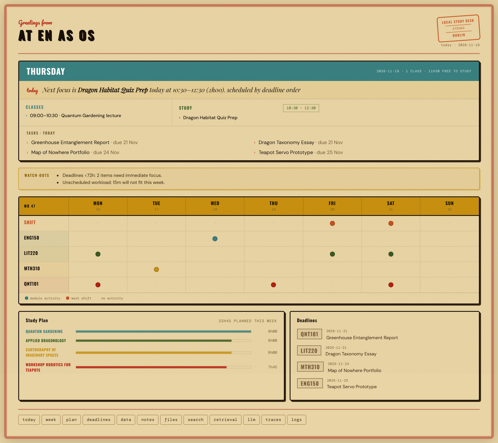

# Atenas

[](https://github.com/nathanlcr/atenas/actions/workflows/ci.yml)

Atenas is a Telegram-first, local study assistant built for students working shifts alongside classes and coursework. Plain Telegram messages go to a bounded tool-calling agent running against local Ollama, while deterministic Python services handle validation, fatigue-aware availability math, SQLite storage, and FTS5 retrieval.



## Why it is built this way

Small local models (`llama3.1:8b`, `llama3.2`) drop context and hallucinate IDs when asked to track timetables, resolve fuzzy assignment names, and plan hours in their head. Atenas keeps the reasoning inside typed tools and deterministic services instead:

```text
The LLM is a tool-calling agent with strong tools.
Deterministic systems validate and do the heavy lifting.
The human approves only what deletes or leaves the machine.
Everything that changes is logged.
```

Plain messages run inside `AgentLoop` (`core/nl/agent.py`) over `ToolRegistry` (`core/nl/tools.py`), carrying conversation goals across turns with bounded iterations and a single JSON repair re-ask if the model outputs invalid tool arguments. Deterministic slash commands (`/status`, `/today`, `/week`, `/plan`, `/pending`, `/cancel_pending`, and write shortcuts) stay available when you want an instant reply without calling the LLM.

## Governance and security

Action tiers are decided in code by `PolicyEngine` (`core/policy_engine.py`), never by the model:

- **Auto** — reversible local writes (`add_assignment`, `add_note`, `add_class_session`, `add_work_shift`, `set_assignment_status`, `set_assignment_hours`, `write_memory`). Arguments pass Pydantic validation, labels resolve to stable UUIDs, the write runs through core services, and the outcome is recorded in SQLite and `logs/events.jsonl`.
- **Confirm-first** — destructive writes (`delete_modules`, `deduplicate_modules`, `archive_note`, `update_memory`, `remove_assignment`, `clear_work_schedule`, `delete_file`) and egress (`web_search`, external messages, cloud LLM calls). These save a pending proposal in `AgentRuntimeStore` and wait for explicit `yes` or `/confirm` from the same Telegram user before running.
- **Forbidden** — `shell_exec`, `modify_source_code`, `edit_env_file`, `read_ssh_keys`, `read_credentials`, `install_package`, `delete_file_silent`, `change_permissions`, `unrestricted_fs_access`, `send_external_message_without_consent`, plus any unknown action type (default-deny).

Transport and egress boundaries:

- **Telegram allowlist** — `AllowlistFilter` checks `TELEGRAM_ALLOWED_USER_IDS` before any command, retrieval, tool, or LLM call runs. Starting with `TELEGRAM_BOT_TOKEN` set and an empty allowlist fails startup validation.
- **Localhost-only web surfaces** — the FastAPI app binds to `127.0.0.1` behind `local_only_guard` middleware (rejects non-loopback peers and non-loopback `X-Forwarded-For` headers unless `ALLOW_NON_LOOPBACK_CLIENTS=true`). The dashboard and REST endpoints (`/health`, `/status`, `/skills`) are read-only.
- **Local Ollama and untrusted data** — non-loopback `OLLAMA_BASE_URL` values are refused unless `ALLOW_EXTERNAL_OLLAMA=true`. Cloud fallback (`ENABLE_CLOUD_FALLBACK`) and web tools (`ENABLE_WEB_TOOLS`) default to `false`. User text (`<user_input>`), retrieved notes (`<source>`), and web snippets (`<web>`) are delimited as untrusted data.

## Quick start

Follow [`docs/GETTING_STARTED.md`](docs/GETTING_STARTED.md) for the full Ollama and BotFather walkthrough, or run locally from a fresh clone:

```bash
python3.11 -m venv .venv
.venv/bin/pip install -r requirements-dev.txt
.venv/bin/pip install -e .
cp .env.example .env
# set TELEGRAM_BOT_TOKEN and TELEGRAM_ALLOWED_USER_IDS in .env
atenas doctor
.venv/bin/uvicorn app.main:app --reload
```

Default Ollama models in `.env.example` are `llama3.1:8b`, `llama3.2`, and `nomic-embed-text`. Once running, open `http://127.0.0.1:8000/dashboard/`.

## CLI and terminal UI

Installing editable (`pip install -e .`) exposes the Click CLI (`app/cli.py`):

```bash
atenas doctor                  # Check runtime dirs, SQLite, Telegram allowlist, Ollama, model profile
atenas traces --limit 20       # Show recent agent traces and tool call counts
atenas tui                     # Launch the read-only curses TUI (or: .venv/bin/python -m app.tui)
atenas backup --include-logs   # Snapshot SQLite, memory/, and inbox/ into output/backups/ (excludes .env)
atenas restore PATH --force    # Restore a backup zip into configured runtime paths
```

The TUI reads the same SQLite database through core services (`1-8` tabs, `/` search, `r` refresh, `q` quit) without mutating state or calling the LLM.

## Telegram tips

Send `/start` for a welcome and `/help` for the full command list (also in
Telegram's command menu). Send a PDF, Markdown or text file as a document to add
it to your library; PDFs and text files are indexed so you can ask questions
about them (limit `TELEGRAM_MAX_UPLOAD_MB`, default 20).

## Docker

`docker-compose.yml` publishes `127.0.0.1:8000:8000` only and mounts `./data`, `./logs`, `./memory`, `./inbox`, and `./output`:

```bash
cp .env.example .env
docker-compose up
```

## Tests

The test suite mocks LLM providers and uses isolated temporary databases, so it passes offline without a running Ollama server or Telegram token:

```bash
.venv/bin/pytest -q
```

Run the suite locally to see the current count.

## Local routes and docs

- **API**: `/health`, `/status`, `/skills`
- **Dashboard**: `/dashboard/`, `/dashboard/week`, `/dashboard/plan`, `/dashboard/deadlines`, `/dashboard/data`, `/dashboard/notes`, `/dashboard/files`, `/dashboard/search`, `/dashboard/retrieval`, `/dashboard/llm`, `/dashboard/traces`, `/dashboard/logs`
- **Docs**: [`docs/AGENT_LOOP.md`](docs/AGENT_LOOP.md), [`docs/PRODUCT_SPEC.md`](docs/PRODUCT_SPEC.md), [`docs/ARCHITECTURE.md`](docs/ARCHITECTURE.md), [`docs/SECURITY.md`](docs/SECURITY.md), [`docs/AGENT_POLICY.md`](docs/AGENT_POLICY.md), [`docs/GETTING_STARTED.md`](docs/GETTING_STARTED.md)

## License

MIT — see [`LICENSE`](LICENSE).
